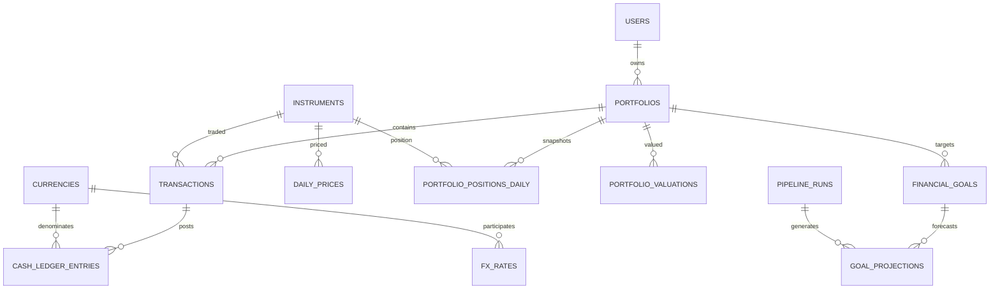

# Investment Portfolio Tracker — Project Plan

> **เอกสารหลักของโปรเจกต์ (Source of Truth)**  
> ใช้เอกสารนี้เพื่อให้ Developer และ AI coding assistant เข้าใจเป้าหมาย ขอบเขต สถาปัตยกรรม กติกาทางธุรกิจ สูตรคำนวณ โครงสร้างข้อมูล และเกณฑ์ยอมรับงานตรงกัน ก่อนแก้ไขหรือเพิ่มฟีเจอร์ให้เปิดอ่านไฟล์นี้ก่อนเสมอ

- Project: **Investment Portfolio Tracker**
- Document: `REQUIREMENTS.md`
- Version: `1.0`
- Status: Initial design / MVP planning
- Primary currency for reports: `THB`
- Initial user mode: Personal use (single user experience; data model supports multiple users)
- Asset scope: Thai and international stocks and ETFs
- Transaction entry: Manual entry by user

---

## 1. Project Overview

### 1.1 What we are building

Investment Portfolio Tracker เป็นเว็บแอปพลิเคชันสำหรับติดตามการลงทุนส่วนบุคคล โดยรวมข้อมูลธุรกรรม ราคาสินทรัพย์ และอัตราแลกเปลี่ยน เพื่อคำนวณผลตอบแทนย้อนหลัง วิเคราะห์สถานะพอร์ต และประเมินความเป็นไปได้ในการบรรลุเป้าหมายทางการเงิน

ระบบไม่ใช่แค่แอปแสดงราคาหุ้นหรือกราฟ แต่เป็น **data-driven application** ที่มี Data Pipeline, data model, data quality checks, reproducible calculations และประวัติผลวิเคราะห์

### 1.2 Primary questions the product must answer

1. ปัจจุบันพอร์ตมีมูลค่าเท่าไร แยกตามสินทรัพย์ สกุลเงิน และเงินสดได้หรือไม่?
2. เงินที่ใส่เข้าพอร์ตสุทธิเท่าไร และกำไร/ขาดทุนจากการลงทุนเป็นเท่าไร?
3. ผลตอบแทนปีที่แล้ว ปีปัจจุบัน รายเดือน และตั้งแต่เริ่มลงทุนเป็นเท่าไร โดยใช้สูตรใด?
4. ผลตอบแทนที่เห็นเกิดจากราคาสินทรัพย์ เงินปันผล หรืออัตราแลกเปลี่ยนมากน้อยเพียงใด?
5. หากใช้เงินลงทุนและสมมติฐานผลตอบแทนที่กำหนด จะบรรลุเป้าหมายเงินก้อนภายในวันเป้าหมายหรือไม่?
6. ต้องมีเงินลงทุนเพิ่มเท่าไรต่อเดือนเพื่อมุ่งไปสู่เป้าหมาย?
7. หากเป้าหมายคือรายได้จากการลงทุนรายเดือน จะต้องมีเงินลงทุนประมาณเท่าไรภายใต้สมมติฐานเงินปันผลหรือ withdrawal rate?
8. เมื่อผลตอบแทนจริงต่างจากแผน ระบบสามารถเปรียบเทียบ Plan vs. Actual และคำนวณ forecast ใหม่ได้หรือไม่?
9. ตัวเลขบน Dashboard สามารถตรวจสอบย้อนกลับไปยังธุรกรรม ราคา FX และสูตรที่ใช้ได้หรือไม่?

### 1.3 Product principles

- **Correctness before visuals:** ความถูกต้องของยอดเงิน ต้นทุน และผลตอบแทนมาก่อนความสวยงามของ Dashboard
- **Ledger first:** ธุรกรรมเป็นแหล่งข้อมูลหลัก ไม่บันทึกเพียงยอดคงเหลือปัจจุบัน
- **Reproducibility:** สร้างผลวิเคราะห์ใหม่ได้จากข้อมูลต้นทางและเวอร์ชันสูตรที่ระบุ
- **No silent assumptions:** ถ้าราคา FX หรือข้อมูลจำเป็นขาด ระบบต้องแสดงสถานะ/ข้อผิดพลาด ไม่สร้างตัวเลขที่ดูเหมือนจริงโดยไม่แจ้ง
- **Historical consistency:** ใช้ข้อมูลที่มีอยู่ ณ วันนั้น ไม่ใช้ราคาหรือ FX จากอนาคตในรายงานย้อนหลัง
- **Idempotent pipelines:** รัน pipeline ซ้ำแล้วไม่สร้างข้อมูลซ้ำหรือเปลี่ยนผลโดยไม่มีเหตุผล
- **Separate facts from forecasts:** ผลตอบแทนย้อนหลังคือข้อเท็จจริงตามข้อมูล ส่วนผลตอบแทนอนาคตเป็นสมมติฐาน ไม่ใช่การรับประกัน

---

## 2. Scope

### 2.1 MVP scope (must-have)

1. สร้างพอร์ตลงทุน โดยมีสกุลเงินรายงานหลักเป็น THB
2. เพิ่มข้อมูลหุ้นและ ETF ไทย/ต่างประเทศ
3. บันทึกธุรกรรมด้วยตนเอง ได้แก่ BUY, SELL, DIVIDEND, DEPOSIT, WITHDRAWAL, SPLIT และ FX_CONVERSION
4. เก็บราคาปิดรายวันของสินทรัพย์และอัตราแลกเปลี่ยน
5. คำนวณจำนวนหน่วยคงเหลือ เงินสดคงเหลือ ต้นทุน และมูลค่าพอร์ตย้อนหลัง
6. คำนวณ realized/unrealized P&L ด้วยวิธีต้นทุนที่เลือกอย่างชัดเจน
7. แสดงผลตอบแทนรายปีและช่วงวันที่ที่เลือก
8. คำนวณ XIRR สำหรับผลตอบแทนจากมุมมองเจ้าของเงิน
9. แสดง cumulative return และ CAGR เมื่อมีเงื่อนไขที่เหมาะสม พร้อมอธิบายข้อจำกัด
10. ตั้งเป้าหมายเงินก้อนและเป้าหมายรายได้จากการลงทุนต่อเดือน
11. คำนวณ projection, เงินลงทุนต่อเดือนที่ต้องใช้ และ Plan vs. Actual
12. มี Data Quality Tests, logging, pipeline run history และ unit tests
13. มี Dashboard ใช้งานได้และ README ที่อธิบายวิธีติดตั้ง/รันระบบ

### 2.2 Next iteration (should-have, after core correctness)

- TWR (Time-Weighted Return) เมื่อ daily valuations และ cash flows ผ่านการตรวจสอบแล้ว
- Scenario comparison แบบ LOW / BASE / HIGH
- แยก contribution จากราคาสินทรัพย์ เงินปันผล และ FX effect
- สร้างประวัติการเปลี่ยนสมมติฐาน/เป้าหมาย
- ปรับปรุง audit trail สำหรับการแก้ไขธุรกรรม
- รองรับนำเข้าไฟล์ CSV ในอนาคต (ไม่อยู่ใน MVP เพราะเริ่มจาก manual entry)
- แจ้งเตือนราคาล้าสมัยหรือเป้าหมายมีแนวโน้มหลุดแผน

### 2.3 Explicitly out of scope for MVP

- เชื่อมต่อบัญชีธนาคารหรือโบรกเกอร์โดยตรง
- ส่งคำสั่งซื้อขายจริง
- ระบบซื้อขายอัตโนมัติหรือคำแนะนำซื้อ/ขายเฉพาะบุคคล
- Cryptocurrency, bonds, mutual funds, options, futures และสินทรัพย์นอกหุ้น/ETF
- Multi-tenant SaaS ที่มีระบบ billing/organization ซับซ้อน
- Kafka, Spark, Kubernetes หรือ distributed data platform ที่ไม่จำเป็นต่อปริมาณข้อมูล MVP
- Machine learning เพื่อทำนายราคาหรือผลตอบแทน

---

## 3. Users and Main Use Cases

### 3.1 Primary user

นักลงทุนรายบุคคลที่ลงทุนหุ้น/ETF ทั้งในไทยและต่างประเทศ ต้องการติดตามผลตอบแทนจริงและแผนการเงินระยะยาว

### 3.2 Main user journeys

**Journey A — Record a buy transaction**
1. ผู้ใช้เลือกพอร์ตและสินทรัพย์
2. ใส่วันเวลา จำนวนหน่วย ราคาซื้อ ค่าธรรมเนียม ภาษี และสกุลเงิน
3. ระบบตรวจสอบค่าและบันทึกธุรกรรมพร้อม cash ledger entry
4. ระบบคำนวณจำนวนหน่วยและเงินสดคงเหลือใหม่
5. valuation pipeline สร้างมูลค่าพอร์ตเมื่อมีราคา/FX ที่เหมาะสม

**Journey B — Review portfolio performance**
1. ผู้ใช้เลือกช่วงเวลา เช่น ปีก่อนหรือ YTD
2. ระบบเลือก valuation และ external cash flows ของช่วงนั้น
3. ระบบคำนวณ metric ตามนิยามที่ระบุ
4. Dashboard แสดงผลลัพธ์ วิธีคำนวณ วันที่ข้อมูลล่าสุด และ warning ถ้าข้อมูลไม่ครบ

**Journey C — Create a financial goal**
1. ผู้ใช้เลือก `TARGET_WEALTH` หรือ `MONTHLY_INCOME`
2. กำหนดวันเป้าหมาย มูลค่าเป้าหมาย เงินลงทุนรายเดือน และสมมติฐาน
3. ระบบคำนวณ projection และ required contribution
4. บันทึก snapshot ของผลคาดการณ์พร้อม scenario/model version
5. Dashboard เปรียบเทียบ actual กับ planned track

---

## 4. Functional Requirements

### 4.1 Portfolio and transaction management

| ID | Requirement | Acceptance criteria |
|---|---|---|
| PORT-01 | Create portfolio | พอร์ตมีชื่อ สกุลเงินฐาน และวันที่เริ่มติดตาม |
| PORT-02 | Register instrument | สินทรัพย์มี symbol, exchange, name, type และ currency |
| TXN-01 | Record BUY | จำนวนหน่วยเพิ่ม และเงินสดสกุลที่ใช้ซื้อถูกหักอย่างถูกต้อง |
| TXN-02 | Record SELL | จำนวนหน่วยลด เงินรับสุทธิถูกเพิ่มใน cash ledger และห้ามขายเกินหน่วยที่มี เว้นแต่เปิดใช้ short position โดยตั้งใจ |
| TXN-03 | Record DIVIDEND | บันทึกรายรับเงินปันผลสุทธิในสกุลเงินที่ได้รับ |
| TXN-04 | Record DEPOSIT/WITHDRAWAL | แยก external cash flow ออกจากกิจกรรมซื้อขายภายในพอร์ต |
| TXN-05 | Record FX_CONVERSION | มี cash ledger entry อย่างน้อยสองสกุลเงิน เพื่อสะท้อนเงินออกและเงินเข้าจากการแลกเงินจริง |
| TXN-06 | Record SPLIT | ปรับจำนวนหน่วยตาม corporate action โดยไม่สร้าง external cash flow |
| TXN-07 | Edit/correct transaction | การแก้ไขมี validation และไม่ทำให้ข้อมูลสรุปเก่าค้างอยู่โดยไม่แจ้ง; ในระบบจริงควรใช้ reversal/audit trail |

### 4.2 Market data and FX

| ID | Requirement | Acceptance criteria |
|---|---|---|
| MD-01 | Daily price ingestion | เก็บราคาปิดรายวันพร้อมวันราคา แหล่งข้อมูล และเวลาที่ดึง |
| MD-02 | FX ingestion | เก็บอัตราแลกเปลี่ยนพร้อม convention ที่ชัดเจน |
| MD-03 | Idempotent upsert | โหลดข้อมูลซ้ำไม่สร้าง key ซ้ำ |
| MD-04 | Data freshness | แสดงวันที่ราคาล่าสุดและเตือนเมื่อล้าสมัยตามปฏิทินตลาด |
| MD-05 | Missing data handling | ไม่ใช้ราคาหรือ FX ในอนาคตแทนค่าที่หายไป |
| MD-06 | Market calendar awareness | แยกวันตลาดปิด/วันหยุดออกจากข้อมูลที่หายผิดปกติ |

### 4.3 Performance Analytics

| ID | Requirement | Acceptance criteria |
|---|---|---|
| PA-01 | Current valuation | คำนวณมูลค่าหุ้น/ETF + เงินสด แปลงเป็น THB ได้ |
| PA-02 | Profit and loss | แยก realized P&L, unrealized P&L, dividends, fees/taxes และ external flows |
| PA-03 | Period returns | เลือก annual, monthly, YTD หรือ custom date range ได้ |
| PA-04 | XIRR | คำนึงถึงวันที่และขนาดกระแสเงินสดจากมุมมองผู้ลงทุน |
| PA-05 | Cumulative return | แสดงเฉพาะเมื่อกำหนดฐานเปรียบเทียบและจัดการ cash flow ถูกต้อง |
| PA-06 | CAGR | แสดงเมื่อมีระยะเวลาและฐานข้อมูลที่เปรียบเทียบกันได้; ไม่เอามูลค่าต้น/ปลายมาคำนวณตรง ๆ หากมี external flows โดยไม่ปรับ |
| PA-07 | TWR | เป็น next iteration หลังมี valuation ณ จุด cash flow ที่เชื่อถือได้ |
| PA-08 | FX awareness | รายงาน THB รวมผลกระทบ FX อย่างสอดคล้องและอธิบายนโยบายแปลงเงิน |
| PA-09 | Explainability | แสดงวันที่ as-of, สูตร/metric และ data quality warnings |

### 4.4 Financial Goal Tracking

| ID | Requirement | Acceptance criteria |
|---|---|---|
| GOAL-01 | Target wealth goal | กำหนดจำนวนเงินและวันเป้าหมายได้ |
| GOAL-02 | Monthly income goal | กำหนดรายได้ต่อเดือนและวิธีประมาณรายได้ได้ |
| GOAL-03 | Assumptions | กำหนดผลตอบแทนคาดหวัง เงินลงทุนรายเดือน เงินเฟ้อ และ income rate ได้ |
| GOAL-04 | Projection | คำนวณ projected value/income ณ วันเป้าหมายได้ |
| GOAL-05 | Required contribution | คำนวณเงินลงทุนรายเดือนที่จำเป็นโดยมี guardrails เมื่อเป้าหมายเป็นไปไม่ได้ภายใต้สมมติฐาน |
| GOAL-06 | Plan vs. Actual | เปรียบเทียบมูลค่าจริงกับมูลค่าตามแผน ณ วันเดียวกัน |
| GOAL-07 | Reforecast history | บันทึก projection แต่ละครั้ง พร้อมวันที่ scenario และ model version |
| GOAL-08 | Forecast disclaimer | ระบุชัดว่าผลคาดการณ์เป็นการจำลอง ไม่รับประกันผลตอบแทน |

---

## 5. Non-Functional Requirements

- **Accuracy:** ใช้ PostgreSQL `NUMERIC` สำหรับยอดเงิน ราคา หน่วย และ FX ที่ต้องคำนวณอย่างแม่นยำ; ระบุ scale และ rounding policy ชัดเจน
- **Reliability:** transaction write ควรใช้ database transaction เพื่อไม่ให้ event ถูกบันทึกครึ่งเดียว
- **Idempotency:** rerun ingestion/model ไม่ทำให้ข้อมูลซ้ำ
- **Traceability:** ทุก market data record มี source/fetched_at; ทุก projection มี model_version และ assumptions
- **Observability:** `pipeline_runs` เก็บสถานะ เวลา rows read/written และ error summary
- **Testability:** business calculations แยกเป็น pure functions เท่าที่ทำได้ และมี known-answer tests
- **Security:** ใช้ environment variables/secrets; ไม่ commit credentials หรือข้อมูลส่วนตัวจริง
- **Maintainability:** แยก ingestion, transformations, business logic, API และ dashboard
- **Reproducibility:** มี seed/sample data และคำสั่งทดสอบที่ทำซ้ำได้

---

## 6. System Architecture

```text
                ┌─────────────────────────────┐
                │ Manual Transaction Entry    │
                │ (Streamlit form / FastAPI)   │
                └──────────────┬──────────────┘
                               │
┌─────────────────────┐  ┌─────▼────────────────┐
│ Market Price Source │─▶│ Python Ingestion     │
└─────────────────────┘  │ Validate / Upsert    │
┌─────────────────────┐  └─────┬────────────────┘
│ FX Rate Source      │────────┘
└─────────────────────┘        │
                               ▼
                    ┌────────────────────────┐
                    │ PostgreSQL              │
                    │ raw / staging / core    │
                    │ intermediate / mart     │
                    └────────────┬───────────┘
                                 │
                    ┌────────────▼───────────┐
                    │ SQL + dbt models        │
                    │ positions / valuations  │
                    │ performance / goals     │
                    └────────────┬───────────┘
                                 │
                    ┌────────────▼───────────┐
                    │ FastAPI / Streamlit     │
                    │ Portfolio dashboard     │
                    └────────────────────────┘
```

### Recommended technology stack

| Concern | Technology | Notes |
|---|---|---|
| Main language | Python | Ingestion, calculation services, scheduling helpers |
| Database | PostgreSQL | Source-of-truth for transactions and market data |
| Transformation | SQL + dbt | Staging, intermediate, mart models and data tests |
| Numerical helpers | pandas / NumPy | Time series and calculation support; define rounding separately |
| API | FastAPI | Optional for separating UI from business services; recommended architecture |
| UI | Streamlit | Fast way to build MVP dashboard |
| Testing | pytest | Unit, integration and regression tests |
| Scheduling | Cron initially | Upgrade to Airflow only if dependency management/orchestration grows |
| Environment | Docker + Docker Compose | Repeatable local setup |
| Market data | Provider adapter; initially evaluate `yfinance` and alternatives | Validate licensing, coverage, adjustments and availability before relying on a source |

**MVP simplification:** It is acceptable to start with Streamlit calling service functions directly. Keep business logic outside UI files so FastAPI can be introduced without rewriting calculations.

---

## 7. Data Model and ERD

### 7.1 Entity relationship overview



### 7.2 Core tables

| Table | Purpose | Key rule |
|---|---|---|
| `users` | User identity | Email unique |
| `portfolios` | Portfolio settings and base currency | Normally `THB` for this project |
| `instruments` | Stock/ETF master data | Identify by symbol + exchange/provider mapping |
| `transactions` | User-entered business events | Append/audit where possible; do not treat every event as external cash flow |
| `cash_ledger_entries` | Signed change to one currency's cash balance | Positive increases cash; negative decreases cash |
| `currencies` | Supported currency definitions | ISO-like 3-letter code |
| `daily_prices` | Per-instrument daily prices | Unique instrument/date/source key |
| `fx_rates` | FX rate history | Direction/convention must be explicit |
| `portfolio_positions_daily` | Historical units/cost/market value per asset | Derived table; rebuildable |
| `portfolio_valuations` | Daily aggregate portfolio snapshot | One portfolio/date/calculation version policy |
| `financial_goals` | Goal definitions and assumptions | Wealth vs monthly-income goal have different semantics |
| `goal_projections` | Immutable projection history | Stores assumptions and model version |
| `pipeline_runs` | Ingestion/model execution log | Status and counts for observability |

### 7.3 Database design rules

1. Use UUID primary keys for entities and foreign keys for relationships.
2. Use `NUMERIC`, not `REAL`/`DOUBLE PRECISION`, for stored monetary amounts and price/quantity values where financial precision matters.
3. Store event timestamps in `TIMESTAMPTZ`, and market price dates as `DATE` in the exchange-local trading date.
4. Store source, fetched timestamp, currency, and relevant data-quality metadata for external market data.
5. Keep user-entered transaction facts immutable where possible; correct mistakes through explicit reversal/correction history rather than silent deletion once valuation history exists.
6. Daily positions and valuations are derived snapshots, not the source of truth; they must be rebuildable from transaction ledger + market data + calculation version.
7. FX convention: `rate` = number of `quote_currency` units for 1 `base_currency` unit. Example: base=`USD`, quote=`THB`, rate=`35.0` means 1 USD = 35 THB.
8. Never add values in different currencies before converting them to a common currency.
9. Do not mix adjusted historical prices with cash dividends already represented in the ledger without a documented total-return methodology; this can double-count dividends.
10. A missing market close on a holiday differs from a missing close on a normal trading day; use source/exchange calendar or a documented fallback policy.

---

## 8. Proposed PostgreSQL Schema (MVP starting point)

> This schema is a design baseline. Implement with migrations and review constraints before production. Additional audit fields and currency-consistency validations may be added as implementation requires.

```sql
CREATE EXTENSION IF NOT EXISTS pgcrypto;

CREATE TABLE users (
    user_id UUID PRIMARY KEY DEFAULT gen_random_uuid(),
    email TEXT NOT NULL UNIQUE,
    created_at TIMESTAMPTZ NOT NULL DEFAULT NOW()
);

CREATE TABLE currencies (
    currency_code CHAR(3) PRIMARY KEY,
    currency_name TEXT NOT NULL
);

CREATE TABLE portfolios (
    portfolio_id UUID PRIMARY KEY DEFAULT gen_random_uuid(),
    user_id UUID NOT NULL REFERENCES users(user_id),
    name TEXT NOT NULL,
    base_currency CHAR(3) NOT NULL REFERENCES currencies(currency_code),
    inception_date DATE NOT NULL,
    created_at TIMESTAMPTZ NOT NULL DEFAULT NOW()
);

CREATE TABLE instruments (
    instrument_id UUID PRIMARY KEY DEFAULT gen_random_uuid(),
    symbol TEXT NOT NULL,
    exchange TEXT NOT NULL,
    name TEXT NOT NULL,
    asset_type TEXT NOT NULL CHECK (asset_type IN ('STOCK', 'ETF')),
    currency CHAR(3) NOT NULL REFERENCES currencies(currency_code),
    provider_symbol TEXT,
    is_active BOOLEAN NOT NULL DEFAULT TRUE,
    created_at TIMESTAMPTZ NOT NULL DEFAULT NOW(),
    UNIQUE (symbol, exchange)
);

CREATE TABLE transactions (
    transaction_id UUID PRIMARY KEY DEFAULT gen_random_uuid(),
    portfolio_id UUID NOT NULL REFERENCES portfolios(portfolio_id),
    instrument_id UUID REFERENCES instruments(instrument_id),
    transaction_type TEXT NOT NULL CHECK (
        transaction_type IN (
            'BUY', 'SELL', 'DIVIDEND', 'DEPOSIT',
            'WITHDRAWAL', 'FX_CONVERSION', 'SPLIT', 'ADJUSTMENT'
        )
    ),
    occurred_at TIMESTAMPTZ NOT NULL,
    currency_code CHAR(3) REFERENCES currencies(currency_code),
    units_delta NUMERIC(24, 10) NOT NULL DEFAULT 0,
    trade_price NUMERIC(24, 10),
    gross_amount NUMERIC(24, 8),
    fee_amount NUMERIC(24, 8) NOT NULL DEFAULT 0 CHECK (fee_amount >= 0),
    tax_amount NUMERIC(24, 8) NOT NULL DEFAULT 0 CHECK (tax_amount >= 0),
    fx_rate_to_base NUMERIC(24, 10),
    external_reference TEXT,
    status TEXT NOT NULL DEFAULT 'POSTED' CHECK (status IN ('DRAFT', 'POSTED', 'VOID')),
    notes TEXT,
    created_at TIMESTAMPTZ NOT NULL DEFAULT NOW(),
    updated_at TIMESTAMPTZ NOT NULL DEFAULT NOW(),
    CHECK (gross_amount IS NULL OR gross_amount >= 0),
    CHECK (trade_price IS NULL OR trade_price > 0),
    CHECK (fx_rate_to_base IS NULL OR fx_rate_to_base > 0),
    CHECK (
      (transaction_type IN ('BUY','SELL') AND instrument_id IS NOT NULL
       AND units_delta <> 0 AND trade_price IS NOT NULL)
      OR transaction_type NOT IN ('BUY','SELL')
    ),
    CHECK (
      (transaction_type = 'BUY' AND units_delta > 0)
      OR (transaction_type = 'SELL' AND units_delta < 0)
      OR transaction_type NOT IN ('BUY','SELL')
    )
);

CREATE INDEX idx_transactions_portfolio_time
    ON transactions(portfolio_id, occurred_at);
CREATE INDEX idx_transactions_instrument_time
    ON transactions(instrument_id, occurred_at);

CREATE TABLE cash_ledger_entries (
    cash_entry_id UUID PRIMARY KEY DEFAULT gen_random_uuid(),
    transaction_id UUID NOT NULL REFERENCES transactions(transaction_id),
    portfolio_id UUID NOT NULL REFERENCES portfolios(portfolio_id),
    currency_code CHAR(3) NOT NULL REFERENCES currencies(currency_code),
    amount_signed NUMERIC(24, 8) NOT NULL,
    entry_role TEXT NOT NULL CHECK (
      entry_role IN ('TRADE', 'DIVIDEND', 'DEPOSIT', 'WITHDRAWAL',
                     'FEE_TAX', 'FX_OUT', 'FX_IN', 'ADJUSTMENT')
    ),
    created_at TIMESTAMPTZ NOT NULL DEFAULT NOW()
);
CREATE INDEX idx_cash_ledger_portfolio_currency
    ON cash_ledger_entries(portfolio_id, currency_code, created_at);

CREATE TABLE fx_conversion_details (
    transaction_id UUID PRIMARY KEY REFERENCES transactions(transaction_id),
    from_currency CHAR(3) NOT NULL REFERENCES currencies(currency_code),
    to_currency CHAR(3) NOT NULL REFERENCES currencies(currency_code),
    amount_from NUMERIC(24, 8) NOT NULL CHECK (amount_from > 0),
    amount_to NUMERIC(24, 8) NOT NULL CHECK (amount_to > 0),
    effective_rate NUMERIC(24, 10) NOT NULL CHECK (effective_rate > 0),
    CHECK (from_currency <> to_currency)
);

CREATE TABLE daily_prices (
    price_id UUID PRIMARY KEY DEFAULT gen_random_uuid(),
    instrument_id UUID NOT NULL REFERENCES instruments(instrument_id),
    price_date DATE NOT NULL,
    close_price NUMERIC(24, 10) NOT NULL CHECK (close_price >= 0),
    adjusted_close NUMERIC(24, 10),
    currency_code CHAR(3) NOT NULL REFERENCES currencies(currency_code),
    source TEXT NOT NULL,
    fetched_at TIMESTAMPTZ NOT NULL DEFAULT NOW(),
    source_updated_at TIMESTAMPTZ,
    quality_status TEXT NOT NULL DEFAULT 'VALID'
      CHECK (quality_status IN ('VALID', 'SUSPECT', 'REJECTED')),
    UNIQUE (instrument_id, price_date, source)
);
CREATE INDEX idx_daily_prices_date ON daily_prices(price_date);

CREATE TABLE fx_rates (
    fx_rate_id UUID PRIMARY KEY DEFAULT gen_random_uuid(),
    base_currency CHAR(3) NOT NULL REFERENCES currencies(currency_code),
    quote_currency CHAR(3) NOT NULL REFERENCES currencies(currency_code),
    rate_date DATE NOT NULL,
    rate NUMERIC(24, 10) NOT NULL CHECK (rate > 0),
    source TEXT NOT NULL,
    fetched_at TIMESTAMPTZ NOT NULL DEFAULT NOW(),
    UNIQUE (base_currency, quote_currency, rate_date, source),
    CHECK (base_currency <> quote_currency)
);

CREATE TABLE portfolio_positions_daily (
    portfolio_id UUID NOT NULL REFERENCES portfolios(portfolio_id),
    instrument_id UUID NOT NULL REFERENCES instruments(instrument_id),
    valuation_date DATE NOT NULL,
    quantity NUMERIC(24, 10) NOT NULL,
    cost_basis_local NUMERIC(24, 8) NOT NULL,
    market_price_local NUMERIC(24, 10),
    market_value_local NUMERIC(24, 8),
    fx_to_base NUMERIC(24, 10),
    market_value_base NUMERIC(24, 8),
    unrealized_pnl_local NUMERIC(24, 8),
    calculation_version TEXT NOT NULL,
    calculated_at TIMESTAMPTZ NOT NULL DEFAULT NOW(),
    PRIMARY KEY (portfolio_id, instrument_id, valuation_date, calculation_version)
);

CREATE TABLE portfolio_valuations (
    portfolio_id UUID NOT NULL REFERENCES portfolios(portfolio_id),
    valuation_date DATE NOT NULL,
    market_value_base NUMERIC(24, 8) NOT NULL,
    cash_value_base NUMERIC(24, 8) NOT NULL,
    total_value_base NUMERIC(24, 8) NOT NULL,
    calculation_version TEXT NOT NULL,
    data_quality_status TEXT NOT NULL DEFAULT 'VALID'
      CHECK (data_quality_status IN ('VALID', 'INCOMPLETE', 'INVALID')),
    valuation_warnings JSONB NOT NULL DEFAULT '[]'::JSONB,
    calculated_at TIMESTAMPTZ NOT NULL DEFAULT NOW(),
    PRIMARY KEY (portfolio_id, valuation_date, calculation_version),
    CHECK (ABS(total_value_base - market_value_base - cash_value_base) < 0.01)
);

CREATE TABLE financial_goals (
    goal_id UUID PRIMARY KEY DEFAULT gen_random_uuid(),
    portfolio_id UUID NOT NULL REFERENCES portfolios(portfolio_id),
    name TEXT NOT NULL,
    goal_type TEXT NOT NULL CHECK (goal_type IN ('TARGET_WEALTH', 'MONTHLY_INCOME')),
    target_wealth_amount NUMERIC(24, 8),
    target_monthly_income NUMERIC(24, 8),
    target_currency CHAR(3) NOT NULL REFERENCES currencies(currency_code),
    target_date DATE NOT NULL,
    expected_annual_return NUMERIC(10, 8) NOT NULL DEFAULT 0.05,
    planned_monthly_contribution NUMERIC(24, 8) NOT NULL DEFAULT 0,
    inflation_rate NUMERIC(10, 8) NOT NULL DEFAULT 0,
    income_method TEXT CHECK (income_method IN ('DIVIDEND_YIELD', 'WITHDRAWAL_RATE')),
    income_rate NUMERIC(10, 8),
    target_in_today_money BOOLEAN NOT NULL DEFAULT FALSE,
    is_active BOOLEAN NOT NULL DEFAULT TRUE,
    created_at TIMESTAMPTZ NOT NULL DEFAULT NOW(),
    updated_at TIMESTAMPTZ NOT NULL DEFAULT NOW(),
    CHECK (expected_annual_return > -1),
    CHECK (planned_monthly_contribution >= 0),
    CHECK (inflation_rate > -1),
    CHECK (
      (goal_type = 'TARGET_WEALTH'
       AND target_wealth_amount IS NOT NULL AND target_wealth_amount > 0
       AND target_monthly_income IS NULL)
      OR
      (goal_type = 'MONTHLY_INCOME'
       AND target_monthly_income IS NOT NULL AND target_monthly_income > 0
       AND target_wealth_amount IS NULL AND income_method IS NOT NULL
       AND income_rate IS NOT NULL AND income_rate > 0 AND income_rate < 1)
    )
);

CREATE TABLE pipeline_runs (
    pipeline_run_id UUID PRIMARY KEY DEFAULT gen_random_uuid(),
    pipeline_name TEXT NOT NULL,
    started_at TIMESTAMPTZ NOT NULL DEFAULT NOW(),
    finished_at TIMESTAMPTZ,
    status TEXT NOT NULL CHECK (status IN ('RUNNING', 'SUCCESS', 'FAILED')),
    rows_read BIGINT NOT NULL DEFAULT 0,
    rows_written BIGINT NOT NULL DEFAULT 0,
    error_message TEXT,
    metadata JSONB NOT NULL DEFAULT '{}'::JSONB
);

CREATE TABLE goal_projections (
    projection_id UUID PRIMARY KEY DEFAULT gen_random_uuid(),
    goal_id UUID NOT NULL REFERENCES financial_goals(goal_id),
    pipeline_run_id UUID REFERENCES pipeline_runs(pipeline_run_id),
    as_of_date DATE NOT NULL,
    scenario TEXT NOT NULL CHECK (scenario IN ('LOW', 'BASE', 'HIGH')),
    projected_portfolio_value NUMERIC(24, 8),
    projected_monthly_income NUMERIC(24, 8),
    required_monthly_contribution NUMERIC(24, 8),
    projected_goal_status TEXT CHECK (
      projected_goal_status IN ('ON_TRACK', 'AT_RISK', 'OFF_TRACK', 'INSUFFICIENT_DATA')
    ),
    assumptions JSONB NOT NULL DEFAULT '{}'::JSONB,
    model_version TEXT NOT NULL,
    created_at TIMESTAMPTZ NOT NULL DEFAULT NOW()
);
CREATE INDEX idx_goal_projections_goal_date
    ON goal_projections(goal_id, as_of_date DESC);
```

### 8.1 Schema implementation notes

- PostgreSQL `CHECK` constraints above handle basic row-level validation. They cannot enforce all cross-row rules, such as preventing a SELL event from making a position negative; validate such rules in a transaction-safe service or database procedure.
- Ensure `cash_ledger_entries` are created in the same database transaction as their parent `transactions` row.
- BUY/SELL cash ledger effects should use the instrument's trading currency. A foreign asset purchase requires available cash in that currency; if funds were exchanged first, record `FX_CONVERSION` with two cash entries.
- For BUY: `amount_signed = -(gross_amount + fee_amount + tax_amount)` in the instrument currency.
- For SELL: `amount_signed = gross_amount - fee_amount - tax_amount` in the instrument currency.
- For DIVIDEND: ledger cash inflow is net of applicable withholding/tax, and currency is the payment currency.
- For DEPOSIT: cash entry is positive; for WITHDRAWAL: cash entry is negative. Those two event types are external cash flows for performance calculations.
- FX_CONVERSION: cash entry is negative in `from_currency` and positive in `to_currency`. `effective_rate` should reconcile `amount_to / amount_from` within the rounding policy. FX conversion is an internal portfolio movement, not an external flow.
- A fee/tax already included in the cash amount for a trade must not be added as a second separate cash ledger entry.
- SPLIT changes share quantity but does not create external cash flow. Its price/quantity treatment must be consistent with the historical-price provider's split-adjustment behavior.
- A daily valuation with missing required market data should be marked `INCOMPLETE` rather than presenting a misleading total as fully valid.
- The database schema does not remove the need for migrations, audit logs, permissions, and integration tests.

---

## 9. Business Rules and Accounting Conventions

### 9.1 Cash and quantities

- `units_delta` is signed from the portfolio's perspective: BUY is positive, SELL is negative.
- `cash_ledger_entries.amount_signed` is signed from the portfolio cash balance's perspective: inflow is positive, outflow is negative.
- Cash balances are maintained separately by currency. Do not sum USD and THB balances until each has been converted to the portfolio base currency.
- Deposits and withdrawals move money between the investor and portfolio. BUY, SELL, DIVIDEND, SPLIT, and FX_CONVERSION are internal portfolio activities for performance attribution, even though some affect cash.
- Dividends count as investment income. If a dividend is retained as cash, it remains part of portfolio value. Do not also count it as a new external contribution.

### 9.2 Cost basis policy

For MVP use **Weighted Average Cost (WAC)** for each instrument position, unless the instrument/market requires another accounting policy. Document that this is the app's portfolio analytics convention, not necessarily the tax-lot method required for local tax filing.

Simplified WAC process:
1. On BUY, add purchase cost plus eligible fees/taxes to the position cost basis.
2. Calculate average cost per unit = position cost basis / quantity held.
3. On SELL, realized P&L = net sale proceeds minus average cost per unit × units sold.
4. Reduce remaining quantity and cost basis using the average cost per unit before sale.
5. Keep dividend income separate from realized P&L (or clearly define an inclusive total-return metric elsewhere).
6. Handle SPLIT by adjusting units and per-unit cost without changing total cost basis.

All buying/selling events should be processed in chronological order with deterministic tie-breaking for transactions at the same timestamp.

### 9.3 Market price policy

- Use the exchange's close date for `price_date`.
- Keep `close_price` and `adjusted_close` distinct.
- Use raw close (with the correct share quantity and corporate actions) for market valuation unless a provider-specific methodology has been reviewed.
- Use adjusted prices for total-return analysis only when the methodology is defined and dividend cash is not counted again in the same metric.
- Do not silently forward-fill indefinitely. A last-known price can be used for a non-trading day only under a documented rule, and the as-of date of that price must remain visible.
- Price provider and FX provider should be replaceable through adapters rather than referenced throughout business logic.

### 9.4 FX policy

- Report values in portfolio base currency, usually THB.
- Store FX direction explicitly: `base_currency` to `quote_currency`, quote units per 1 base unit.
- To convert `amount` from USD to THB, use USD->THB rate and multiply.
- For the reverse direction, divide by the USD->THB rate or use a separately sourced THB->USD rate with an explicit convention.
- Store FX used for a transaction if needed for transaction-time reporting, but daily valuations should use the valuation-date FX policy consistently.
- FX conversion inside the portfolio is not an external flow; it must not be treated as investment contribution/withdrawal.
- FX effects for international holdings may be shown as an approximate decomposition in MVP; do not claim exact attribution unless the calculation method is documented and tested.

---

## 10. Performance Metric Definitions

The application must label the selected metric in the UI or documentation. “Return” without a definition is not enough.

### 10.1 Portfolio market value

For valuation date `t`:

`portfolio_value_base(t) = sum(position_quantity(i,t) * close_price(i,t) * fx_to_base(i,t)) + sum(cash_balance(currency,t) * fx_to_base(currency,t))`

All terms must be converted to the portfolio base currency before summing. If a required price or FX rate is missing, mark valuation incomplete and list affected positions/currencies.

### 10.2 External cash flows

- Investor contributes money to portfolio: negative cash flow from the **investor's perspective** for XIRR.
- Investor withdraws money from portfolio: positive cash flow from the investor's perspective for XIRR.
- At the end date, add terminal portfolio value as a positive cash flow from the investor's perspective.
- Internal trades, dividends retained in the portfolio, and FX conversions are not external flows.
- If dividends are paid out of the portfolio to the investor as a withdrawal, model the external withdrawal, not a second synthetic dividend cash flow in XIRR.

### 10.3 XIRR

Find annualized rate `r` that solves:

`sum(CF_i / (1 + r) ** ((date_i - date_0).days / 365)) = 0`

- Requires at least one negative and one positive cash flow.
- Cash flows use investor perspective signs as defined above.
- Use daily dates; define what to do with same-day transactions.
- Report when XIRR has no valid solution, multiple possible solutions, insufficient history, or incomplete terminal valuation. Do not silently replace errors with zero.
- XIRR is a money-weighted return: it reflects timing and size of external contributions/withdrawals.

### 10.4 TWR

TWR estimates investment performance while neutralizing the impact of the investor's external cash-flow timing. Compute sub-period returns around each external flow when the system has reliable valuation points:

`TWR = product(1 + subperiod_return_j) - 1`

TWR is a follow-up feature because an accurate implementation requires valuation immediately before/after flows or a clearly documented daily approximation. Do not label a simple start/end calculation as TWR if external cash flows occurred.

### 10.5 Annual return, cumulative return, CAGR

- Annual return for a calendar year must have a named methodology: preferably TWR for portfolio performance and/or annual XIRR for investor experience. If only XIRR is provided, label it `Annual XIRR`, not generic annual market return.
- Cumulative performance should be calculated with a cash-flow-aware methodology; do not use `(ending value / starting value) - 1` when additional external cash flows occurred unless those flows are properly adjusted.
- CAGR is only valid when start/end values are comparable after accounting for external flows, or when applied to a return series/equivalent method. Never compute CAGR from raw portfolio balance start/end if contributions occurred in the middle.
- Annualized return is not the arithmetic average of annual returns. If displaying average return, explicitly distinguish arithmetic average from geometric/annualized return.

### 10.6 P&L definitions

- `unrealized_pnl` = market value of open position minus remaining cost basis under the selected cost policy.
- `realized_pnl` = net sale proceeds minus the cost basis of units sold.
- `dividend_income` = net dividend received.
- `fees_and_taxes` should be tracked as costs and not subtracted twice.
- `net_contributed_capital` = external deposits minus external withdrawals, excluding dividends and internal FX conversions.
- Total investment gain must use one clearly documented convention; avoid summing mutually overlapping metrics without reconciliation.

---

## 11. Goal Tracking and Forecasting Rules

### 11.1 Goal types

**A. `TARGET_WEALTH`**
- Input: target wealth, target date, current portfolio value, planned monthly contribution, expected annual return, inflation assumption and target currency.
- Output: projected value at target date, required monthly contribution to target, gap to target and status.

**B. `MONTHLY_INCOME`**
- Input: target monthly income, desired date to reach it, income method, income rate and assumptions.
- `DIVIDEND_YIELD`: estimated capital requirement = annual income target / assumed dividend yield (adjusted for the chosen gross/net and tax convention).
- `WITHDRAWAL_RATE`: estimated capital requirement = annual income target / assumed withdrawal rate.
- Output: implied target capital, projected monthly income and contribution needed to approach that capital goal.
- A dividend yield and a sustainable withdrawal rate mean different things. UI must identify which method is being used.

### 11.2 Forecast model

MVP deterministic projection assumes monthly contributions and a constant annualized return converted to an effective monthly rate:

`monthly_rate = (1 + annual_return) ** (1 / 12) - 1`

For `n` months, starting portfolio value `PV`, monthly contribution `PMT` made at **month-end**, and monthly rate `r`:

If `r != 0`:

`FV = PV * (1 + r) ** n + PMT * (((1 + r) ** n - 1) / r)`

If `r == 0`:

`FV = PV + PMT * n`

The formula and whether contributions are at month-end or month-start must be consistent across UI, backend, tests and README.

### 11.3 Required contribution

Solve the same future-value formula for `PMT`; handle zero return and the cases where the target is already reached. If the target is mathematically impossible under constraints or the required contribution is negative, return a meaningful status rather than an invalid amount.

### 11.4 Inflation handling

- Keep the user-selected goal amount in the currency chosen by the goal.
- If `target_in_today_money = true`, inflate the target amount from today to target date before comparing nominal projections, using the goal's inflation assumption.
- Clearly label nominal target versus today's purchasing-power target.
- Avoid applying inflation twice (once to target and again to required amount).

### 11.5 Projection scenarios and status

- `LOW`, `BASE`, `HIGH` represent user-selected or documented return assumptions. They are not probabilities.
- `ON_TRACK`, `AT_RISK`, `OFF_TRACK` must use an explicit rule, such as projected value relative to target and a tolerance threshold. Document the rule and make it configurable later.
- Store assumptions and `model_version` with each projection.
- Label forecasts as estimates, not guarantees.

---

## 12. Data Pipeline Design

### 12.1 Jobs

1. **Instrument master sync** — check/update symbol, exchange, provider symbol and currency.
2. **Price ingestion** — fetch historical/incremental prices, validate source response and upsert.
3. **FX ingestion** — fetch currency pairs required by active portfolios.
4. **Staging** — normalize dates, types, currencies, source symbols and duplicate handling.
5. **Data quality** — validate uniqueness, nullability, plausible values, freshness and coverage.
6. **Position calculation** — process posted transactions chronologically and derive quantities/cost basis.
7. **Daily valuation** — mark each asset and cash account to market in base currency.
8. **Performance models** — compute period returns/XIRR from validated inputs.
9. **Goal projections** — calculate scenarios and record historical projections.
10. **Dashboard refresh** — serve the most recent valid mart data and display freshness.

### 12.2 Data layers

| Layer | Purpose | Example objects |
|---|---|---|
| `raw` (optional for MVP) | Evidence of source payloads | raw API responses or fetched-file metadata |
| `staging` | Normalize/validate incoming source data | `stg_daily_prices`, `stg_fx_rates`, `stg_transactions` |
| `intermediate` | Derive domain entities | `int_positions_daily`, `int_cash_balance_daily`, `int_external_cash_flows` |
| `mart` | Dashboard-ready analytics | `mart_portfolio_daily`, `mart_annual_returns`, `mart_goal_progress` |

### 12.3 Incremental loading

- Use upsert keyed by stable business key, e.g. `(instrument_id, price_date, source)`.
- Track `fetched_at`, source and run ID.
- Support reprocessing a date range when upstream data changes (e.g. corporate action corrections).
- Do not only fetch “today”; backfill required history during initial setup.
- Make job retries safe and idempotent.

### 12.4 Failure behavior

- Mark failed pipeline run as `FAILED` and store a concise error message.
- Do not publish a valuation as fully valid if required price/FX inputs failed.
- Preserve the last valid snapshot but display its as-of date and stale/incomplete warning.
- Retry transient network errors with a bounded retry strategy; do not retry permanent validation errors indefinitely.

### 12.5 Scheduling

Start with Cron or a simple scheduler. Run after the relevant exchanges' closing data is usually available, and avoid assuming all global markets close at the same local date/time. For this project's scale, Airflow is optional and should only be added when DAG dependency management, retries, backfills and monitoring justify it.

---

## 13. Data Quality and Observability

### 13.1 Required tests

- Unique: no duplicate price record for the selected business key.
- Not-null: instrument, market date, price, currency, source and FX rate fields required for a calculation are present.
- Accepted values: transaction types, asset types, statuses and scenario names are valid.
- Relationships: transactions refer to valid portfolios/instruments; ledger entries refer to valid transactions/currencies.
- Positive values: FX rate > 0, price >= 0, units and trade price valid under the transaction type.
- Currency consistency: trade currency matches instrument currency unless a documented market-specific rule applies.
- Position reconciliation: derived quantities equal cumulative signed transaction units after split/corporate-action treatment.
- Cash reconciliation: balance by currency equals sum of signed ledger entries.
- Valuation reconciliation: total = asset market value + translated cash value.
- FX coverage: every currency valuation has an approved rate or a documented same-currency rate of 1.
- Freshness: stale inputs are flagged based on the exchange calendar/source SLA.
- No look-ahead: no price/FX observation dated after valuation date is used.
- Return calculation: XIRR uses only external flows plus terminal value, not internal trades.
- Projection consistency: formulas handle zero return, already-met goal, zero contribution and positive contribution cases.

### 13.2 Pipeline logs

Minimum log fields: `pipeline_run_id`, job name, started/finished timestamp, status, rows read, inserted/updated/rejected counts, backfill date range, data source, error summary and code/model version.

### 13.3 Alert conditions

- Price or FX coverage incomplete for an active holding.
- Unexpected sharp price movement (flag for review, not auto-correct silently).
- Duplicate/conflicting price data from a provider.
- Transaction produces negative units or unexpected negative cash balance.
- Daily valuation changes unexpectedly because input data was revised.
- Goal projection is incomplete or falls materially behind target.

---

## 14. Dashboard and API Requirements

### 14.1 Pages

1. **Portfolio Overview** — total value, net external contributions, realized/unrealized P&L, cash by currency, asset allocation and latest valuation date.
2. **Performance Analytics** — return by period, XIRR, yearly chart, portfolio value history and calculation methodology.
3. **Transactions** — searchable transaction ledger, add/edit/void flow, validation messages and notes.
4. **Asset Detail** — position quantity, average cost, current price, market value, P&L, currency and history.
5. **Goals** — create/edit target wealth and monthly income goals.
6. **Goal Progress** — actual versus planned value, projected target-date value, required monthly contribution, scenario comparison and assumptions.
7. **Data Health** — pipeline history, latest source timestamps, missing prices/FX, failed tests and incomplete valuations.

### 14.2 UI rules

- Show base currency clearly.
- Show whether values are as-of market close or latest available data.
- Identify percentage metrics (XIRR, TWR, CAGR) by name; don't show an unlabeled “return %”.
- Show warnings rather than hide incomplete data.
- Separate realized P&L, unrealized P&L, dividends, fees/taxes and external flows.
- Show scenario assumptions near forecast numbers.

### 14.3 Suggested API routes (if FastAPI is used)

- `GET /health`
- `GET /portfolios`
- `POST /portfolios`
- `GET /portfolios/{portfolio_id}/summary`
- `GET /portfolios/{portfolio_id}/valuations?from=YYYY-MM-DD&to=YYYY-MM-DD`
- `GET /portfolios/{portfolio_id}/performance?metric=xirr&from=...&to=...`
- `GET /portfolios/{portfolio_id}/transactions`
- `POST /portfolios/{portfolio_id}/transactions`
- `POST /portfolios/{portfolio_id}/transactions/{transaction_id}/void`
- `GET /instruments`
- `POST /instruments`
- `GET /portfolios/{portfolio_id}/goals`
- `POST /portfolios/{portfolio_id}/goals`
- `GET /goals/{goal_id}/projections`
- `POST /goals/{goal_id}/reforecast`
- `GET /data-health/pipeline-runs`

For a single-user local MVP, some routes may be postponed, but the service layer and business rules should still be kept separate from presentation code.

---

## 15. Testing Strategy

### 15.1 Test layers

- **Unit tests:** calculations for positions, WAC cost basis, FX conversion, XIRR, goal projections.
- **Integration tests:** database write/read, constraints, transaction+ledger atomicity, upsert behavior.
- **Data tests:** uniqueness, nulls, relationships, freshness, reconciliation and missing inputs.
- **Regression tests:** fixed test fixtures with known expected results.
- **End-to-end tests:** create portfolio → add transactions → ingest market data → valuation → analytics → goal projection.

### 15.2 Required fixture scenarios

1. Deposit THB 100,000; buy 10 units at THB 5,000; price increases to THB 5,500. Verify cash and holding value reconcile.
2. Buy then sell part of a position. Verify quantity, remaining basis and realized P&L under WAC.
3. Buy a USD-listed ETF using USD cash after a THB→USD FX conversion. Verify each currency cash balance and THB valuation.
4. Receive a net dividend. Verify portfolio value and dividend metric are correct without double-counting.
5. Apply a split. Verify quantity changes and aggregate cost basis remains unchanged.
6. Add deposit mid-period. Verify it is not counted as investment return and XIRR uses the correct date.
7. Add withdrawal. Verify cash balance decreases and withdrawal is a positive investor-perspective XIRR flow.
8. Missing FX on valuation date. Verify valuation is flagged incomplete rather than silently reported as valid.
9. Duplicate source price ingestion. Verify only one selected record per key is used.
10. Goal projection at 0% return, positive return, negative-but-valid return, zero contribution and target already reached.
11. Data provider revises a historical price. Verify targeted reprocessing updates derived models and records model/calculation version.
12. Same-day transactions. Verify deterministic chronological processing and consistent output.

### 15.3 Definition of Done for calculations

A calculation is not complete until it has:
- A documented definition and sign convention.
- A deterministic implementation.
- At least one normal-case test, one edge-case test and one invalid-data test.
- Reconciliation with the underlying transactions/prices/cash ledger.
- UI labeling and limitations if the result is shown to the user.

---

## 16. Development Roadmap (10 Weeks)

| Week | Focus | Deliverables |
|---|---|---|
| 1 | Requirements and modeling | Finalized glossary, ERD, schema migration, seed data |
| 2 | Manual transactions | Transaction form/service, validation, cash ledger, unit tests |
| 3 | Market data ingestion | Price/FX provider adapters, backfill, upsert and run logging |
| 4 | Data quality and staging | Staging models, source freshness, tests and data health view |
| 5 | Portfolio accounting | Position engine, WAC cost basis, cash reconciliation, daily valuations |
| 6 | Performance analytics | Period returns, XIRR, cumulative return policy, annual summary tests |
| 7 | Goal tracking | Wealth/income goals, required contribution and deterministic projections |
| 8 | Plan vs. Actual | Scenario snapshots, reforecast, projection history and status rules |
| 9 | Dashboard and end-to-end tests | Overview/performance/goals pages, integration and regression tests |
| 10 | Packaging and documentation | Docker Compose, Cron, README, architecture/ERD, demo data and known limitations |

Timeline is an estimate for a personal project. Keep the correctness requirements even if visual features are reduced to meet the timeline.

---

## 17. Recommended Repository Layout

```text
investment-portfolio-tracker/
├── app/
│   ├── api/                    # FastAPI routes (if enabled)
│   ├── services/               # Business logic; no UI dependencies
│   ├── calculations/           # Position, P&L, returns, FX and goal formulas
│   └── dashboard/              # Streamlit pages
├── pipelines/
│   ├── ingest_prices.py
│   ├── ingest_fx.py
│   ├── validate_inputs.py
│   ├── build_positions.py
│   ├── build_valuations.py
│   └── build_performance.py
├── dbt_project/
│   └── models/
│       ├── staging/
│       ├── intermediate/
│       └── marts/
├── sql/
│   ├── migrations/
│   └── seeds/
├── tests/
│   ├── unit/
│   ├── integration/
│   └── fixtures/
├── docs/
│   ├── ERD.md
│   ├── DATA_DICTIONARY.md
│   └── CALCULATION_METHODOLOGY.md
├── docker-compose.yml
├── Dockerfile
├── .env.example
├── .gitignore
├── requirements.txt or pyproject.toml
├── PLAN.md
└── README.md
```

Use one dependency manager consistently. Prefer `pyproject.toml` for a new Python project, or `requirements.txt` for a simpler learning setup; do not maintain conflicting dependency lists without a reason.

---

## 18. AI Collaboration Contract

This section is intended for ChatGPT/Codex/other coding assistants working in this repository.

### 18.1 Before making changes

1. Read `REQUIREMENTS.md` before proposing architecture or changing business rules.
2. Inspect the current repository, existing migrations, tests and README before creating replacement files.
3. State which requirements/sections the task affects and identify assumptions that are not decided.
4. Prefer the smallest coherent change over large unrelated rewrites.
5. Preserve established field names, return definitions, currency sign conventions and transaction semantics unless there is an explicit decision to change them.

### 18.2 Implementation rules

- Treat `REQUIREMENTS.md` as the product/architecture source of truth, but report conflicts found in actual code or migrations instead of blindly overwriting them.
- Do not make up market data, FX rates, price coverage or test results.
- Do not silently change the definition of a return metric.
- Do not use future prices/FX in historical calculations.
- Do not count deposits, withdrawals, internal trades, dividends and FX conversions interchangeably.
- Do not count trade fees/taxes twice.
- Keep business calculations independent from Streamlit/FastAPI presentation logic.
- Add or update unit/regression tests for calculation changes.
- Add migrations for schema changes; don't assume a modified `schema.sql` upgrades an existing database.
- Handle missing/stale data explicitly and surface warnings in the UI.
- Use environment variables for credentials and include safe placeholders in `.env.example`.
- Keep dependencies minimal; explain why a new library is needed.
- Never claim code or tests passed unless the relevant commands were actually run.

### 18.3 Expected response for an AI coding task

For each implementation task, the AI should provide:
1. **Understanding:** one-paragraph summary of the task and requirements affected.
2. **Plan:** short list of files/modules to change.
3. **Implementation:** code changes with sensible error handling and comments for non-obvious logic.
4. **Validation:** tests/commands actually run and their results; be clear when tests were not run.
5. **Impact:** schema changes, migration instructions, data backfill needs and limitations.
6. **Documentation:** update `REQUIREMENTS.md`, README or calculation methodology docs when behavior/contracts change.

### 18.4 Suggested starter prompt for an AI coding assistant

```text
Read PLAN.md completely and treat it as the project source of truth.
Inspect the existing repository before changing anything. Work only on the task I specify.
Preserve the transaction sign conventions, currency/FX conventions, external-cash-flow definitions,
metric definitions and data-quality rules in PLAN.md. Do not invent data or claim tests passed
unless you run them. Before coding, summarize the affected requirements and proposed files.
After coding, run relevant tests and report exact results, migrations, assumptions and limitations.
```

---

## 19. Project Risks and Decisions to Keep Visible

| Risk / decision | Why it matters | Mitigation |
|---|---|---|
| Inconsistent external cash-flow signs | Makes XIRR wrong | Use investor-perspective sign convention in calculation layer and test it |
| Double-counting dividends | Inflates return | Keep cash dividends and adjusted-price total return methodologies distinct |
| Multi-currency cash not modeled | Overstates/understates portfolio value | Maintain cash ledger per currency and record FX conversion explicitly |
| Source price coverage/licensing | Data may be incomplete or unsuitable | Evaluate source coverage/terms and isolate provider behind an adapter |
| Corporate actions | Split/dividend handling may distort units/returns | Store split events or use a fully documented adjusted-data strategy; test fixtures |
| Stale FX/price data | Produces inaccurate valuation | Freshness tests, market calendars and incomplete status |
| Cost basis differs from tax accounting | P&L may not match tax records | Label WAC as analytics convention and document limits |
| Forecast interpreted as guarantee | Leads to false certainty | Show assumptions, scenarios and disclaimer; no promise of returns |
| Inaccurate goal income model | Dividend yield differs from total return/withdrawal | Make method and rate explicit; distinguish gross/net income |
| Schema change without migration | Breaks users' data | Use versioned migrations and backup before destructive changes |

### Decisions to make only when needed

- Final market price/FX provider and its terms.
- The exact exchange calendars and treatment of non-trading days.
- Whether to support fractional shares, short positions, multi-lot tax basis or more asset classes.
- Final TWR implementation and external-flow valuation convention.
- Whether Goal Tracking should use nominal money or today's purchasing power by default.
- Authentication/deployment model once the app is no longer local/private.

Do not block the initial MVP on decisions that are explicitly marked as later-stage, but never fake support for an unimplemented behavior.

---

## 20. MVP Acceptance Checklist

### Business functionality
- [ ] Create a portfolio with THB base currency.
- [ ] Register Thai and international stocks/ETFs with exchange and local currency.
- [ ] Record BUY, SELL, DIVIDEND, DEPOSIT, WITHDRAWAL, FX_CONVERSION and SPLIT.
- [ ] Show cash balances by currency and positions by instrument.
- [ ] Show current and historical portfolio value with data freshness.
- [ ] Show realized/unrealized P&L with the defined WAC policy.
- [ ] Calculate and label XIRR from external flows + terminal value.
- [ ] Report annual/period performance without treating contributions as returns.
- [ ] Create target wealth and monthly income goals.
- [ ] Show projected value/income, required contribution, scenarios and Plan vs. Actual.

### Data engineering
- [ ] Price/FX ingestion supports historical backfill and incremental upsert.
- [ ] Pipeline run logs store status, time, counts and error details.
- [ ] Data quality tests detect duplicate, missing and implausible inputs.
- [ ] Derived models are rebuildable and calculation versions are recorded.
- [ ] Missing prices/FX result in visible incomplete status/warning.
- [ ] Re-running the pipeline is idempotent.

### Engineering and delivery
- [ ] Calculation unit tests and integration tests pass.
- [ ] Seed/test data contains multi-currency and external-flow edge cases.
- [ ] Docker/local setup and environment instructions are documented.
- [ ] README describes architecture, setup, sample workflow and limitations.
- [ ] `REQUIREMENTS.md` and data dictionary match implemented behavior.

---

## 21. Glossary

| Term | Meaning in this project |
|---|---|
| Portfolio | กลุ่มสินทรัพย์และเงินสดที่ติดตามร่วมกัน |
| Instrument | หุ้นหรือ ETF หนึ่งรายการในตลาดหนึ่งและสกุลเงินหนึ่ง |
| Transaction | เหตุการณ์ทางธุรกิจที่ผู้ใช้บันทึก เช่น ซื้อ ขาย ฝาก ถอน |
| Cash ledger | การเปลี่ยนแปลงยอดเงินสดแยกตามสกุลเงิน |
| External cash flow | เงินที่ไหลระหว่างเจ้าของเงินกับพอร์ต ไม่รวมซื้อขายภายในพอร์ต |
| Valuation | การตีมูลค่าสินทรัพย์และเงินสด ณ วันที่กำหนด |
| Realized P&L | กำไร/ขาดทุนที่เกิดจากการขายหน่วยที่ถือ |
| Unrealized P&L | กำไร/ขาดทุนจากมูลค่าตลาดของหน่วยที่ยังถืออยู่เทียบกับต้นทุน |
| XIRR | ผลตอบแทนต่อปีแบบ money-weighted ซึ่งคำนึงถึงวันและขนาดกระแสเงินสด |
| TWR | ผลตอบแทนที่พยายามตัดผลของ timing ของ external cash flows |
| CAGR | อัตราเติบโตทบต้นต่อปีเมื่อฐานเริ่มต้น/ปลายทางเปรียบเทียบกันได้ |
| FX | อัตราแลกเปลี่ยนระหว่างสกุลเงิน |
| WAC | Weighted Average Cost; วิธีเฉลี่ยต้นทุนของหน่วยที่ถือ |
| Data mart | ตาราง/โมเดลที่เตรียมข้อมูลให้พร้อมสำหรับการวิเคราะห์และ Dashboard |
| Idempotent | การรันซ้ำไม่สร้างผลข้างเคียงหรือข้อมูลซ้ำโดยไม่ตั้งใจ |
| Projection | ผลคาดการณ์ตามสมมติฐาน ไม่ใช่ผลลัพธ์ที่รับประกัน |

---

## 22. First Implementation Milestone

The first coding milestone should **not** be the dashboard. It should establish a correct and testable transaction/valuation foundation.

1. Create repository structure, Python environment and PostgreSQL Docker Compose.
2. Add migrations for currencies, users, portfolios, instruments, transactions and cash ledger.
3. Seed sample currencies and a small set of fictional/test instruments.
4. Implement transaction validation and atomic posting to `transactions` + `cash_ledger_entries`.
5. Implement deterministic position quantity and WAC cost basis calculations.
6. Add unit tests for BUY, SELL, DEPOSIT, WITHDRAWAL, DIVIDEND, FX conversion and SPLIT.
7. Only after those pass, implement market price/FX ingestion and daily valuations.

**Success criterion for Milestone 1:** For a given transaction fixture, the system can reproduce each instrument's units and cost basis plus each currency's cash balance deterministically, and tests confirm that external cash flows are not confused with investment performance.
